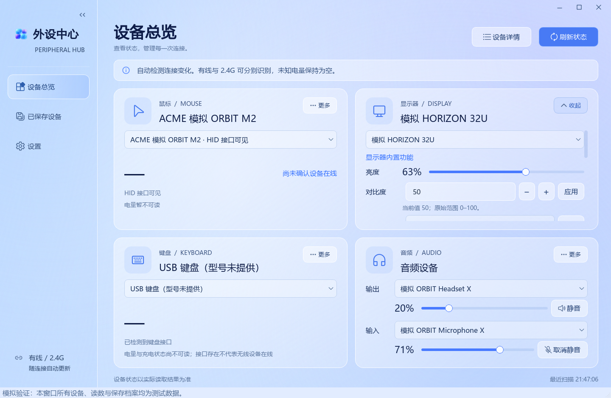

# PeripheraHub

面向 Windows 11 的集成式外设管理工具，使用 C++20 和 Qt 6 Widgets。应用内部名称和可执行文件名为 **PeripheralHub**。

**当前版本：0.0 · 初始预览版。** 将显示器、鼠标、键盘和音频设备放在一个窗口中，提供已实现的状态读取与基础控制。此版本用于公开源码和收集反馈，尚未完成四款目标设备的全部功能及系统兼容性验收。

## 当前功能

| 模块 | 已实现 | 当前边界 |
|---|---|---|
| 设备总览 | 动态卡片、同类多设备选择、详情展开、可收起侧栏 | 系统枚举到接口不代表无线设备本体在线 |
| 显示器 | 系统型号识别、亮度调节、能力探测、按条件开放高级功能 | DDC/CI 能力由设备决定；H24T7 矛盾枚举保持只读 |
| 音频 | 输入/输出独立选择、音量、静音、托盘调节 | 调节 Windows 音频端点，不提供应用独立混音 |
| VGN F2 Master+ | 电量、DPI、档位、回报率、按键记录和性能参数读取 | 仅限定型号；实验性写入默认关闭 |
| ATK N9 V2 ULTRA | 电量、状态和 10 段 PEQ 读取，并关联到音频端点 | 本版不提供耳机 EQ 写入和音效算法 |
| LANGTU L98 | 系统接口与名称发现 | 电量、RGB、改键尚未适配 |
| 设备档案 | 按身份保存、确认状态、受限重连恢复、离线档案删除 | 不自动切显示器输入源，不恢复未确认的私有参数 |
| 日常使用 | 系统托盘、低于 10% 电量提醒、刷新间隔、关闭行为设置 | 暂无全局快捷键、开机自启、云同步或固件升级 |

实现入口、验证方法和型号边界见 [功能核对](docs/FEATURES.md)。

## 界面示意



图中设备、标识和参数均为模拟测试数据，用于展示界面，不代表新增型号的实机适配。

## 设备验证范围

- **KTC H24T7**：亮度已有实机改变/恢复证据。输入源、情景和色彩预设回报与能力表存在矛盾；曾报告软件切源后持续花屏，因此不能标为已适配切源。
- **VGN Dragonfly F2 Master+**：2.4G 接收器的读取已有实机记录。DPI 档位、回报率和当前档位已完成探针写入、回读和改回；物理效果、断电保存、有线/无线及充电切换仍待验收。
- **ATK 海王星 N9 V2 ULTRA**：2.4G 接收器的电量与 PEQ 读取已有实机记录。有线、充电切换和 EQ 写入验收未完成。
- **LANGTU L98**：目前只有系统接口发现，不将型号识别等同于完整协议支持。

其他型号优先使用 Windows 提供的名称和标准能力；不会仅凭品牌名称向未知设备发送私有设置命令。

## 实验性设备写入

默认关闭。只有在“设置”中主动开启后，已匹配的 VGN F2 Master+ 才显示三类写入控件：档位 DPI、回报率、当前档位。每次只提交白名单中的一项并回读；失败不自动重试或回滚。开启此功能不代表已经完成所有实机验收。

N9 EQ 写入、鼠标按键/宏写入、键盘 RGB/改键、恢复出厂和固件升级均未作为本版产品功能开放。开发探针与日常应用分开，详见 [已知问题](docs/RELEASE_0.0.md)。

## 获取与构建

GitHub 仓库：[daizime/PeripheraHub](https://github.com/daizime/PeripheraHub)。0.0 首次发布提供源码、功能说明和构建方法；Windows 候选运行包仍有独立的硬件及分发验收要求。

构建需要 Windows、支持 C++20 的 MSVC x64、CMake 3.21 或更高版本，以及 Qt 6.5 或更高版本的 Core、Gui、Widgets。当前本机验证环境使用 Qt 6.7.0 与 MSVC。

在项目根目录的 PowerShell 中运行，按本机安装位置修改参数：

```powershell
.\scripts\build.ps1 `
  -QtRoot "C:\Qt\6.7.0\msvc2019_64" `
  -VsRoot "C:\Program Files\Microsoft Visual Studio\2022\Community" `
  -BuildDirectory "$PWD\work\build-release" -RunTests
```

脚本可通过 `-CMakePath` 指定 CMake。默认工具路径来自开发机，脚本不会自动下载安装依赖。

仅构建原生库与非 Qt 测试：

```powershell
.\scripts\build.ps1 -NoGui -BuildDirectory "$PWD\work\native" -RunTests
```

生成本地候选包时，使用同一 Qt/VS 安装并指定对应的 Qt 源码目录：

```powershell
.\scripts\package.ps1 `
  -QtRoot "C:\Qt\6.7.0\msvc2019_64" `
  -VsRoot "C:\Program Files\Microsoft Visual Studio\2022\Community" `
  -QtSourceRoot "C:\Qt\6.7.0\Src" `
  -BuildDirectory "$PWD\work\build-release" `
  -OutputDirectory "$PWD\outputs\PeripheralHub-0.0" `
  -RequireEmptyOutput -IncludeApplicationSources
```

打包要求 Release 构建和测试成功，检查源码摘要与 EXE 哈希。不要只复制 EXE，运行时需保留 DLL、平台插件及配置。对外分发说明见 [DISTRIBUTION.md](docs/DISTRIBUTION.md)。

## 测试

Qt 组件和集成测试使用模拟设备后端，不会向真实硬件写入参数。仅编译开发探针也不会执行写入；实际写入需要独立命令和明确操作。

```powershell
.\scripts\verify-all.ps1 -BuildDirectory "$PWD\work\build-release"
```

GitHub CI 验证无 Qt 的原生构建与核心测试；完整 Qt 回归和实机验收是不同层次。当前结果见 [0.0 发布记录](docs/RELEASE_0.0.md) 与 [验证说明](docs/VALIDATION.md)。

## 使用和本地数据

- 默认数据目录为 EXE 同目录的 `data`，也可用 `--data-dir "目录"` 指定。
- `settings.ini` 保存程序选项、设备选择及关联；`devices.json` 保存设备档案；`peripheral-hub.log` 为本地诊断日志。
- 系统托盘可用时，默认关闭窗口会收起到托盘；完全退出使用托盘菜单或 `Ctrl+Q`。
- 数据、日志、构建产物和研究下载不上传到仓库。反馈问题前请移除设备唯一标识和个人路径。
- 升级前备份自己的 `data`。0.0 使用新的候选包目录，不会自动删除旧目录或修改旧数据。

## 已知限制

真实睡眠/唤醒、多屏、重复拔插、充电与通道切换、第二台无开发环境 Windows 11 电脑仍待验收。系统消息触发的唤醒重扫已实现，但不等于真实休眠已通过。当前运行包未签名。

开发期 N9 探针曾改动测试设备 Custom 曲线第 0 点，原值未能恢复；相关情况保留在 [协议研究记录](docs/PRIVATE_WRITE_CANDIDATES_2026-10-19.md)。本版应用没有开放 N9 EQ 写入。

## 项目结构

- `src/core`：设备身份、协议编解码和控制队列。
- `src/platform`：Windows HID、Core Audio 和显示器后端。
- `src/app`：服务、设备档案与 Qt 界面。
- `tests`：核心、组件和模拟集成回归。
- `scripts`：构建、验证、打包与开发验收脚本。
- `tools`：图标处理和独立硬件探针源码。
- `docs`：功能边界、协议、架构和发布记录。

## 许可证与贡献

项目原创代码采用 **AGPL-3.0-or-later**，见 [LICENSE](LICENSE) 和 [COPYING.md](COPYING.md)。Qt、Fluent System Icons 和其他参考材料保留各自许可，见 [THIRD_PARTY_NOTICES.md](THIRD_PARTY_NOTICES.md)。

提交设备支持时，请说明 VID/PID、连接方式、协议来源，以及哪些行为经过实机验证。公开仓库存在代码不等于所有型号或全部固件均已适配。